# agentic-development-workflow

A demonstration of AI coding agents integrated into a GitHub issue-based development lifecycle. Each agent has its own GitHub identity, runs in an isolated container per event, and interacts via PR and issue comments — the same channels a human contributor would use.

**This is a demonstration project, not an open project.** Pull requests are limited to collaborators. Issue reports from the public are welcome but may not be acted on. If you want to run this workflow yourself, see [Reproduce this yourself](#reproduce-this-yourself) below.

See [docs/design-philosophy.md](docs/design-philosophy.md) for why the system is shaped the way it is, [requirements.md](requirements.md) for the full project specification, [AGENTS.md](AGENTS.md) for agent conventions, and [CONTRIBUTING.md](CONTRIBUTING.md) for the contribution policy.

## What this demonstrates

This repository shows how coding agents can participate in a structured, human-gated software development lifecycle on GitHub:

- **Separate agent identities** — each agent (developer, reviewer) authenticates as its own GitHub App, so its actions are distinguishable from human collaborators and from each other.
- **Least-privilege, per-event isolation** — agents run in ephemeral containers, each receiving a short-lived installation token scoped to only the permissions that action requires.
- **Full issue → merge lifecycle** — from grooming and design through implementation, CI, code review, and deployment, every step is driven by GitHub labels and events; humans gate the transitions that matter (applying labels, approving PRs, merging).
- **Human-enforced branch protection** — branch protection on `main` requires at least one human review; agents cannot self-approve or push directly to `main`.

## Agent lifecycle

The complete flow from issue to deployment is:

**issue → groom → (design →) implement → CI → review → respond → merge → deploy**

- A human opens an issue and optionally applies `agent:groom` to classify it and surface clarifying questions.
- For complex issues the groomer applies the `plan` label; a human applies `agent:design` to produce a design document and draft sub-issues before implementation begins.
- A human applies `agent:developer` to trigger implementation on a fresh branch; the agent opens a PR.
- CI runs automatically; an explicitly allowed actionable check failure re-invokes the agent (`fix-checks`) to diagnose and commit fixes for the entrypoint to publish.
- A human (or the agent itself) applies `agent:review` to request a code review from the reviewer agent.
- On review feedback the developer agent addresses it (`respond-review`) and commits updates for the entrypoint to publish; the cycle repeats until the PR is approved.
- A human squash-merges the approved PR; the issue auto-closes via `Closes #N`.
- On deployment failure the agent opens a follow-up fix-up PR and the cycle restarts.

See the action functions in [`docker/scripts/entrypoint.sh`](docker/scripts/entrypoint.sh) for `AGENT_ACTION` values and required env vars.

For `fix-checks` and `respond-review`, the model tests and commits locally, then the entrypoint publishes after the session. Review replies cite real commits without claiming unpublished commits are already remote. In contrast, the `implement` model still pushes its branch and opens a draft PR; the entrypoint injects the marker and makes the PR ready for review. `design` publication also remains model-owned.

The planned temporary model-session pre-push guard diagnoses an ordinary in-session push and directs the model to commit locally and return. Client hooks can be bypassed with `--no-verify`, configuration overrides, another clone, or an API; they are not authorization or containment. See the [guard design](docs/design/fix-checks-entrypoint-publication.md).

If an entrypoint push is rejected, rerun from the current remote or manually recover unpublished local commits if they remain available; the ephemeral clone may not survive. Do not retry with force or a newly fetched lease to force publication. The [shared concurrency lock](docs/design/shared-branch-concurrency-group.md) does not cover humans or other outside writers. See the [respond-review publication safety design](docs/design/entrypoint-force-with-lease.md) for its checkout-pinned lease.

## How it works

Day-to-day operation is driven entirely by GitHub labels and events. See [`AGENTS.md § Labels`](AGENTS.md#labels) for the full label reference — all `agent:*`, `model:*`, grooming, and lifecycle labels with their descriptions and workflow behavior.

- Allowed check failure on an agent-authored PR → the agent is re-invoked to fix the checks. `agent-fix-checks` receives same-repository Actions failures through its explicit `workflow_run` subscriptions (including [`CI`](.github/workflows/ci.yml)) and other eligible origins through `check_run.completed`; [`agent-fix-checks-poll.yml`](.github/workflows/agent-fix-checks-poll.yml) polls every 15 minutes as a delivery-independent backstop. `FIX_CHECKS_ALLOW` is a universal opt-in across all of these paths: `[]` disables all fix-checks handling, and each JSON entry must exactly match a raw Checks API `check_runs[].name`, not a workflow name or a decorated Checks-tab label. A `human-required` label stops polling for that PR; remove it when the human has unblocked the work to re-enable automatic handling.
- Push to `main` → the agent checks all open developer-agent PRs for merge conflicts and resolves them automatically; each conflicted PR is resolved in its own parallel job so a single failure does not block the others. If the agent cannot resolve a conflict confidently, it aborts, applies `human-required`, and posts a PR comment naming the files that need manual attention. `workflow_dispatch` with a `pr_number` input is available as a manual backstop for a specific PR — for example, to manually re-trigger conflict resolution for PR #42:

  ```bash
  gh workflow run agent-resolve-conflicts.yml \
    --repo mfrancza/agentic-development-workflow \
    -f pr_number=42
  ```
- PR review submitted on an agent-authored PR → the agent addresses feedback and pushes.
- Deployment failure → the agent opens a follow-up fix-up PR. (Triggers on any `deployment_status` failure; skips cleanly unless it can map the failing deployment SHA to a PR containing `Closes #N`.)
- **Terraform CI pipeline** — every PR that touches `terraform/**` triggers a plan-on-PR workflow ([`.github/workflows/terraform-ci.yml`](.github/workflows/terraform-ci.yml)) that runs `fmt -check`, `validate`, and `terraform plan`, then posts the plan output as an evergreen PR comment so reviewers can see what will change. On merge to `main` the same workflow auto-applies the plan. The pipeline authenticates to GitHub as the `terraform-ci` App (minted via [`.github/actions/agent-token`](.github/actions/agent-token/action.yml)) and to HCP Terraform's state backend via `TF_API_TOKEN`. See [`docs/design/terraform-ci.md`](docs/design/terraform-ci.md) for the full design and threat-model rationale.
- **CI run logs** — container logs and Claude session transcripts are captured as workflow artifacts with 30-day retention. See [AGENTS.md](AGENTS.md#debugging) for download instructions and what each artifact contains.

Only usernames (and agent bot identities such as `<developer-agent-app-slug>[bot]`) in the Terraform-managed `AGENT_ALLOWLIST` can trigger the label-driven workflows (`agent:groom`, `agent:developer`, `agent:review`, `agent:design`, `agent:resolve-conflicts`). The allowlist may also contain same-organization `org/team-slug` references; resolving those entries requires the optional `ALLOWLIST_RESOLVER_APP_ID` and `ALLOWLIST_RESOLVER_APP_PRIVATE_KEY` repository secrets, while login-only lists need no resolver credential. The agent bots are included so an agent can apply `agent:*` labels to hand work off — for example, the developer agent applying `agent:review` on its own PR to request a code review. Event-driven workflows then apply their own gates: `fix-checks`/`respond-review` run only for developer-agent PRs, and `fix-deployment` runs on any failed `deployment_status` event and skips cleanly unless it can map the deployment SHA to a PR containing `Closes #N`.

See [AGENTS.md](AGENTS.md) for the full list of `AGENT_ACTION` values and their required env vars.

## SDLC diagram

The diagram below shows the end-to-end issue → merge → deploy lifecycle, including which steps are performed by agents (blue) and which require a human decision (green). Label-driven triggers are shown on the edges.

```mermaid
flowchart TD
    Start([User opens GitHub issue]):::human --> GroomLabel{"Apply <code>agent:groom</code>?"}:::human

    GroomLabel -- "yes" --> Groom["<b>Grooming agent</b><br/>(AGENT_ACTION=groom)<br/>classifies issue, adds labels,<br/>asks clarifying questions"]:::agent
    GroomLabel -- "no" --> PlanCheck{"Issue labeled <code>plan</code>?"}:::human
    Groom --> PlanCheck

    PlanCheck -- "yes" --> DesignLabel{"Apply <code>agent:design</code>?<br/>(user must be in AGENT_ALLOWLIST)"}:::human
    PlanCheck -- "no" --> DevLabel{"Apply <code>agent:developer</code>?<br/>(user must be in AGENT_ALLOWLIST)"}:::human

    DesignLabel -- "yes" --> Design["<b>Designer agent</b><br/>(AGENT_ACTION=design)<br/>creates <code>design/issue-{N}</code>,<br/>writes design doc, opens PR,<br/>creates sub-issues labeled <code>draft</code>"]:::agent
    DesignLabel -- "no" --> WaitDesign([Wait for user]):::human
    WaitDesign -- "agent:design applied later" --> DesignLabel
    Design --> DesignMerge["Human reviews and merges<br/>design PR<br/>(<code>draft</code> auto-removed from sub-issues)"]:::human
    DesignMerge --> DevLabel

    DevLabel -- "no" --> Wait([Wait for user]):::human
    Wait -- "agent:developer applied later" --> DevLabel
    DevLabel -- "yes" --> Implement["<b>Developer agent</b><br/>(AGENT_ACTION=implement)<br/>creates <code>agent/issue-{N}</code>,<br/>implements solution, opens PR"]:::agent

    Implement --> CI{"CI checks pass?"}:::system
    CI -- "no" --> FixChecks["<b>Developer agent</b><br/>(AGENT_ACTION=fix-checks)<br/>diagnoses failures,<br/>commits fixes"]:::agent
    FixChecks --> CI

    CI -- "yes" --> ReviewLabel{"Apply <code>agent:review</code>?<br/>(human or developer agent;<br/>re-fires on each push while labeled)"}:::human
    ReviewLabel -- "yes" --> ReviewerAgent["<b>Reviewer agent</b><br/>reviews PR changes,<br/>posts review"]:::agent
    ReviewLabel -- "no (human reviews directly)" --> Review{"PR review submitted"}:::human
    ReviewerAgent --> Review

    Review -- "changes requested" --> Respond["<b>Developer agent</b><br/>(AGENT_ACTION=respond-review)<br/>addresses feedback,<br/>commits updates"]:::agent
    Respond --> CI

    Review -- "approved (≥1 human review; admins may bypass)" --> Merge["Human squash-merges PR to <code>main</code><br/>(issue auto-closed by <code>Closes #N</code> on merge)"]:::human
    Merge --> Deploy{"Deployment succeeds?"}:::system

    Deploy -- "no" --> FixDeploy["<b>Developer agent</b><br/>(AGENT_ACTION=fix-deployment)<br/>diagnoses failure,<br/>opens fix-up PR"]:::agent
    FixDeploy --> CI

    Deploy -- "yes" --> Done([Deployment successful]):::system

    classDef human fill:#d4edda,stroke:#155724,color:#155724
    classDef agent fill:#cfe2ff,stroke:#084298,color:#084298
    classDef system fill:#fff3cd,stroke:#664d03,color:#664d03
```



Notes on the diagram:

- **Human gates** (green) are the only places a person is required: opening the issue, applying `agent:*` labels, reviewing and merging the design PR, submitting a PR review, and squash-merging. Branch protection on `main` requires at least one human review before merge for non-admins — agents cannot self-approve. Repository admins can bypass the review requirement and merge via PR without a prior review (see the Terraform ruleset note in the [Reproduce this yourself](#reproduce-this-yourself) section).
- **Agent steps** (blue): developer agent steps each run as a fresh container invocation of the developer agent image (`docker/`) with a specific `AGENT_ACTION`; the reviewer agent step uses a separate image (`docker/reviewer/`) and performs exactly one action (review a PR). See [AGENTS.md](AGENTS.md#agent-actions) for the required env vars per action.
- **System checks** (yellow) are automated (GitHub Actions workflow checks, deployment status events) and drive the feedback loops back into the agent. The fix-checks feedback loop runs only for an allowed actionable check on an agent-authored PR. `CI` ([`.github/workflows/ci.yml`](.github/workflows/ci.yml)) is one same-repository delivery subscription; `FIX_CHECKS_ALLOW` independently controls the universal, exact Checks-API-name opt-in.
- `fix-deployment` re-enters the flow at the CI/checks stage because it opens a new PR that goes through the same CI → review → merge lifecycle as any other change (including the `fix-checks` feedback loop if checks fail).

## Reuse in another repo

The Terraform modules and GitHub Actions reusable workflows in this repo are
published as versioned artifacts — any repository can adopt them one component
at a time, from a single label set to the full agent pipeline.

See **[docs/adopting.md](docs/adopting.md)** for the complete consumer
adoption guide, including:

- Adoption profiles (labels-only, grooming only, review only, full pipeline)
- Common prerequisites (GitHub Apps, secrets, Terraform provider config)
- Version pinning strategy (pin an exact release tag such as `@v0.2.1`; the moving `@v0` is not advised before 1.0)
- Per-module and per-workflow sections with copy-paste wiring snippets
- Manual repository settings (fork-PR approval policy, interaction limit)

## Dependabot alert issue scheduling

The [design](docs/design/fixable-dependabot-alert-issues.md) specifies an opt-in producer for eligible Dependabot alerts; it feeds the existing issue-grooming path rather than implementing fixes itself. Terraform publishes `ENABLE_DEPENDABOT_ALERT_ISSUES` as `"false"` by default and `DEPENDABOT_ALERT_ISSUES_MAX_OPEN_PRS` as `"3"`. Set `enable_dependabot_alert_issues` and `dependabot_alert_issues_max_open_prs` per repository in Terraform, or set the equivalent repository Actions variables directly if not using this module. The limit must be a non-negative integer; `0` pauses new admissions but allows inventory and recovery of missing grooming handoffs for already reserved issues.

- **Human approval and bootstrap:** Before enabling, a human must approve the proposed reader permissions, the issue body fields and redaction policy (alert details in ordinary issues may broaden disclosure, especially in public repositories), and the admission limit/counting policy. Roll out in an approved sandbox and verify real error shapes and credentials before a separate production opt-in.
- **Reader identity:** The proposed dedicated repository-scoped GitHub App has Dependabot alerts read and Pull requests read, plus implicit Metadata read; it has no issue, contents, administration, organization, or alert-write permission. A human provisions and installs it and sets repository secrets `DEPENDABOT_READER_APP_ID` (App Client ID) and `DEPENDABOT_READER_APP_PRIVATE_KEY` outside Terraform. The reader token is used only for alert queries and never enters model containers; there is no PAT fallback.
- **Writer identity:** Issue and label writes use a separately minted token from the existing `DEVELOPER_APP_ID` and `DEVELOPER_APP_PRIVATE_KEY` secrets. The existing developer identity must already satisfy the repository's authorization gates; neither its permissions nor the reviewer identity's permissions are expanded. Each adopter separately approves and provisions its own Apps, secrets, existing authorization setup, and opt-in.
- **Entry points:** See [the scheduler workflow](.github/workflows/agent-dependabot-alert-issues.yml) for its trigger and opt-in gate; this integration is repository-local and does not provide a reusable workflow.
- **Supported evidence:** Only open alerts with a non-withdrawn advisory, a patch for that vulnerability, a supported typed repository-fixable update error, and no associated update PR qualify. Source/error adapters must establish a repository-edit repair path and public/default registry access; unknown or ambiguous errors, private-source/authentication failures, and unsupported ecosystems are skipped, not guessed. Missing credentials, forbidden fields, partial GraphQL errors, or incomplete inventories fail visibly before candidate publication, not as an empty scan.
- **Identity and capacity:** Exact per-alert issue markers identify both open and closed issues; a closed marked issue is a tombstone, suppressing recreation even if its alert remains open or reopens. Old issues are not automatically closed or reopened. Capacity counts open dependency PRs covered by the design (including drafts) once each and reserves one slot per open marked issue not yet represented by a counted PR. A PR replaces its issue's reservation; multiple PRs count separately. With limit 3, one counted PR and one unrepresented issue leave one admission.
- **Limitations and rollback:** This is a scheduler admission reservation, not a strict global PR cap: humans, Dependabot, and other writers can create PRs concurrently or reopen work. Lowering the limit or disabling opt-in prevents further admissions but does not close existing issues/PRs, cancel already admitted or running work, revoke credentials, or remove published alert details. Remove access separately through a human-controlled process if required.

## Reproduce this yourself

The steps below describe how to wire up the same workflow in your own GitHub repository. Most repo-side configuration (Terraform settings, GitHub Actions workflows, and agent images) is in this repo — fork it and follow the steps; a few one-time manual steps outside version control (creating GitHub Apps, adding secrets) are also required and are covered in the steps below.

### 1. Create the agent GitHub Apps (one-time, manual)

Terraform cannot create GitHub Apps, so do this first in the GitHub UI under **Settings → Developer settings → GitHub Apps → New GitHub App**. Create the developer-agent, reviewer-agent, and terraform-ci Apps, plus the allowlist-resolver App when an agent user list uses a team reference:

**developer-agent**
- Repository permissions: Contents (R/W), Issues (R/W), Pull requests (R/W), Workflows (R/W), Metadata (R), Checks (R), Deployments (R)
- Subscribe to events: Issues, Pull request, Pull request review, Check run, Deployment status
- Webhook: **uncheck "Active"** — the GitHub UI otherwise requires a Webhook URL, and this project uses `workflow_dispatch` rather than webhooks.
- After creation: note the **Client ID** (labelled "Client ID" in the App's General settings page — a string like `Iv23.xxxxxxxxxxxxxxxx`, **not** the numeric "App ID") and generate + download a **private key** (`.pem`).

**reviewer-agent**
- Repository permissions: Contents (R), Issues (R/W), Pull requests (R/W), Metadata (R), Checks (R)
- Subscribe to events: Pull request, Pull request review, Issue comment
- Webhook: **uncheck "Active"** (same reason as above).
- After creation: note the **Client ID** (same as above — the `Iv23.xxx` string) and download the private key.

**terraform-ci**
- Repository permissions: Administration (R/W), Metadata (R), Contents (R), Issues (R/W), Actions (R/W)
- Subscribe to events: none (App is only used to mint tokens for Terraform runs; no webhook events needed).
- Webhook: **uncheck "Active"** (same reason as above).
- After creation: note the **Client ID** (the `Iv23.xxx` string) and download the private key.

**release-ci**
- Repository permissions: Contents (R/W), Workflows (R/W), Metadata (R).
- Subscribe to events: none (App is only used to mint tokens for release tag pushes; no webhook events needed).
- Webhook: **uncheck "Active"** (same reason as above).
- After creation: note the **Client ID** (the `Iv23.xxx` string) and download the private key.

**allowlist-resolver**
- Organization permissions: Members (R).
- Repository permissions: Metadata (R).
- Subscribe to events: none.
- Webhook: **uncheck "Active"**.
- Install the App on the organization that owns the repository.
- After creation: note the Client ID and download the private key.

Then install the developer-agent, reviewer-agent, terraform-ci, and release-ci Apps on this repository (sidebar → **Install App** → **Install** next to your username → **Only select repositories** → pick `agentic-development-workflow`). Install allowlist-resolver on the repository-owning organization so it can read that organization's team membership. Terraform deliberately does not manage App installations (the GitHub API endpoints for it reject OAuth user tokens, which is what `gh auth token` issues).

### 2. Run Terraform

`terraform/terraform.tfvars` is committed in this repository and contains the
operational configuration for this deployment (repo owner/name, agent allowlist,
auto-trigger flags, assignee/reviewer lists). Nothing in it is a secret — secrets
live only in Actions secrets (step 3). If you are setting up your own fork, edit
`terraform/terraform.tfvars` directly:

```
#   repo_owner           — GitHub user or org that owns the repo
#   repo_name            — repository name (default: agentic-development-workflow)
#   agent_allowlist      — GitHub usernames, agent bot identities (e.g.
#                          myfork-developer-agent[bot]), and same-organization
#                          org/team-slug references permitted to trigger workflows
#   default_model        — repo-wide default model (e.g. "sonnet")
#   design_default_model — (optional) design-agent default model; when set,
#                          agent-design prefers this over default_model; omit or
#                          set to "" to fall back to default_model (the default)
#   groom_default_model  — (optional) grooming-agent default model; when set,
#                          agent-groom prefers this over default_model and uses
#                          its vendor (Anthropic/OpenAI/xAI) as the fallback
#                          provider when selecting a model:* label; omit or
#                          set to "" to fall back to default_model (the default)
#   auto_trigger_agents  — per-stage auto-trigger switches (all false by default;
#                          set a key to true to auto-apply that stage's agent:* label)
#   auto_review_authors — explicit GitHub logins whose same-repository PRs
#                          auto-enroll for review; [] disables enrollment
#   admin_assignees      — (optional) GitHub usernames or same-organization
#                          org/team-slug references assigned on grooming or review-round
#                          escalation; stored as the JSON-encoded
#                          ADMIN_ASSIGNEES Actions variable; omit or set to [] to skip
#   max_review_rounds   — (optional) non-negative safe integer; Terraform publishes
#                          MAX_REVIEW_ROUNDS as a string. Default 8; 0 means no
#                          numerical cap. Missing Actions variable defaults to 8.
#   code_reviewers       — (optional) GitHub usernames or org/team-slug references to
#                          request as PR reviewers when the implement agent determines
#                          human review is warranted; stored as the JSON-encoded
#                          CODE_REVIEWERS Actions variable; omit or set to [] to request
#                          no specific reviewers
#   reviewer_models      — (optional) ordered list of model identifiers for the
#                          multi-reviewer feature; stored as the JSON-encoded
#                          REVIEWER_MODELS Actions variable; omit or set to [] to
#                          disable multi-reviewer (the default)
#   pre_commit_check_cmd — (optional) shell command run by the pre-commit checks
#                          backstop after any agent push that touches .github/.
#                          The command runs inside pre_commit_scripts_dir and is
#                          fully responsible for setup (e.g. dependency install)
#                          as well as the actual checks. Stored as the
#                          PRE_COMMIT_CHECK_CMD Actions variable. Omit or set to
#                          "" to disable the backstop (the default) — configure
#                          per-deployment so the Docker image does not assume any
#                          particular repo stack.
#                          Example: "npm ci && npm run typecheck && npm test"
#   pre_commit_scripts_dir — (optional) path relative to the checkout root where
#                          pre_commit_check_cmd runs. Stored as the
#                          PRE_COMMIT_SCRIPTS_DIR Actions variable when non-empty.
#                          Omit or set to "" to use the built-in default of
#                          .github/scripts without creating an Actions variable.
```

**Auto-review upgrade:** The new `auto_review_authors` list defaults to `[]`,
which disables automatic enrollment even when `auto_trigger_agents.review` is
`true`. Before upgrading, configure:

```hcl
auto_review_authors = ["<developer-agent-app-slug>[bot]"] # add other desired author logins
auto_trigger_agents = { groom = false, design = false, developer = false, review = true }
```

Keep your existing values for the other switches. The authorized operator must
apply the reviewed Terraform plan, and update the caller inputs and reusable pin
together as described in the [adopting guide](docs/adopting.md#agent-auto-trigger-reusable-workflow).
The list accepts logins only, including bot logins; teams and wildcards are not
supported. Unlisted authors do not enroll merely because their branches begin
with `agent/` or `design/`. Manual `agent:review` labeling remains available.
Author enrollment grants no sender permissions: keep the developer App in
`AGENT_ALLOWLIST` for downstream review authorization.

```bash
cd terraform

export GITHUB_TOKEN=$(gh auth token)  # or any token with `repo` scope

# TF_API_TOKEN authenticates to the HCP Terraform remote state backend.
# Generate a token in the HCP Terraform UI under User Settings → Tokens,
# then export it before running terraform init:
export TF_API_TOKEN="<hcp-terraform-api-token>"

terraform init

# Import the repo. The ID is the plain repo name — whatever you set for
# var.repo_name in terraform.tfvars (default: agentic-development-workflow).
terraform import github_repository.this "$(terraform console <<<'var.repo_name' | tr -d '"')"

terraform plan
terraform apply  # first-time bootstrap only; subsequent applies run via the CI pipeline
```

**If you already have local state from a previous `terraform apply` run** (i.e.
a `terraform.tfstate` file exists in `terraform/`), run `terraform init
-migrate-state` instead of `terraform init` to copy the existing state into the
HCP workspace before the first CI-driven apply:

```bash
terraform init -migrate-state
# Terraform prompts: "Do you want to copy existing state to the new backend? yes"
```

After migration the HCP workspace holds the canonical state. Local
`terraform apply` is reserved for the initial bootstrap (before CI is live)
and break-glass situations — ongoing applies run automatically via CI on every
merge to `main` that touches `terraform/**`. See
[`docs/design/terraform-ci.md`](docs/design/terraform-ci.md) Decision 7 and
the State backend bootstrap section for the full sequence.

Terraform will:
- Codify repo settings (squash-merge only, delete branch on merge, etc.).
- Apply branch protection on `main` via a repository ruleset (PR review required, no force pushes, no deletion, linear history — direct pushes to `main` blocked for everyone, admins included; admins can bypass review only via PR merges).
- Publish `AGENT_ALLOWLIST`, `DEFAULT_MODEL`, and `AUTO_TRIGGER_AGENTS` as repo-level Actions variables so workflows reference them without hardcoding values in YAML.
- Publish `RESOLVE_CONFLICTS_AUTHOR_ALLOWLIST` as a JSON array of PR author logins to add to the conflict-resolution sweep (`[]` by default preserves agent-only behavior; `["*"]` selects all authors, excluding fork-headed PRs).
- Create the labels consumed by the agent workflows (`agent:developer`, `agent:groom`, `agent:review`, `agent:design`, the Anthropic tier aliases `model:sonnet`/`model:opus`/`model:haiku` plus the generic series tags and pinned snapshot IDs for the currently active Claude model families, the OpenAI and xAI `model:*` labels, the grooming labels `question`/`bug`/`enhancement`/`dependency upgrade`/`do`/`plan`, `human-required` for issues/PRs needing a human in the loop, `draft` for sub-issues scoped by an unmerged design, and `blocked` for issues whose `agent:developer` trigger was deferred pending blocker closure) so they show up in the GitHub label picker on issue and pull request creation.

If `terraform apply` errors with `422 already_exists` on a default GitHub label (`bug`, `enhancement`, `question` — these ship pre-created on new repos), import them and re-apply:

```bash
terraform import 'github_issue_label.automation["bug"]'         "$(terraform console <<<'var.repo_name' | tr -d '"'):bug"
terraform import 'github_issue_label.automation["enhancement"]' "$(terraform console <<<'var.repo_name' | tr -d '"'):enhancement"
terraform import 'github_issue_label.automation["question"]'    "$(terraform console <<<'var.repo_name' | tr -d '"'):question"
```

App private keys are deliberately **not** managed by Terraform — keeping them out of `terraform.tfstate` is the whole point. Set them as repo Actions secrets out of band (next step).

### Review-response round limit

The response gate counts distinct commit SHAs from submitted reviews by configured automated reviewers since the current budget epoch began, excluding the PR author. Human reviews do not count; repeated reviews of a SHA count once, and dismissed reviews remain counted. For a limit of N, actionable feedback on the Nth reviewed commit pauses before another response (with 8, commits 1–7 may receive responses); clean feedback does not escalate. Missing or whitespace-only `MAX_REVIEW_ROUNDS` defaults to 8 even before Terraform is applied; `0` disables the numerical cap, not the pause label. Invalid values or accounting errors fail the job without starting a container. Existing PR history is counted immediately on rollout, so an already-over-limit PR pauses on its next actionable event.

At the threshold, the developer App applies `human-required`, attempts to assign `ADMIN_ASSIGNEES`, and posts an escalation comment. Assignment is best-effort: missing configuration, unavailable team resolution, invalid assignees, and capacity or assignment failures produce warnings in the run and comment. Configure explicit logins or same-organization `org/team-slug` entries; teams require the optional `ALLOWLIST_RESOLVER_APP_ID` and `ALLOWLIST_RESOLVER_APP_PRIVATE_KEY` secrets. No assignee is guessed when none is available.

**Human resume:** Investigate and resolve the original escalation, then remove `human-required` from the PR and obtain a fresh authorized review. For automated re-review, remove and reapply `agent:review` through the authorized label path, or push a deliberate update while that label remains. A fresh authorized human review can also trigger a response. Removing the label does not itself trigger the workflow, and rerunning an older review does not resume it. Any `human-required` label pauses this action, even if applied for a different reason; other escalation labels have separate runbooks. Only a human removal starts a new epoch, and reviews at the same timestamp as removal remain in the old epoch.

The gate does not cancel an already-running response, block external pushes or reviewer runs, or prevent independent branch-writing actions. See [the review-round design](docs/design/cap-review-response-rounds.md).

Adopting callers of `agent-respond-review-reusable.yml` can pass optional string inputs `max-review-rounds`, `reviewer-logins` (JSON array), `escalation-assignee` (login), and `admin-assignees` (JSON array of logins or teams). Empty `max-review-rounds` defaults to 8, and empty `reviewer-logins` uses the built-in reviewer identities. Custom reviewer logins affect accounting only and do not authorize review triggers; callers must retain their PR-author and self-review gates, and the reusable's existing review-author allowlist remains in force. Pass the adopter's own configuration explicitly, for example `max-review-rounds: ${{ vars.MAX_REVIEW_ROUNDS }}` and `admin-assignees: ${{ vars.ADMIN_ASSIGNEES }}`.

### 3. Set App credentials and API keys as Actions secrets

Run once after `terraform apply`, and again whenever you rotate a key:

```bash
# Required — used by all current agent workflows
gh secret set DEVELOPER_APP_ID         --body "<developer App Client ID>"  # the Iv23.xxx Client ID, not the numeric App ID
gh secret set DEVELOPER_APP_PRIVATE_KEY < ~/.config/agentic-agents/developer-agent.pem
gh secret set ANTHROPIC_API_KEY        --body "<anthropic api key>"
gh secret set OPENAI_API_KEY           --body "<openai api key>"      # optional if not using OpenAI models
gh secret set XAI_API_KEY             --body "<xai api key>"         # optional if not using Grok models

# Required for the reviewer agent (used by agent-review.yml)
gh secret set REVIEWER_APP_ID          --body "<reviewer App Client ID>"   # the Iv23.xxx Client ID, not the numeric App ID
gh secret set REVIEWER_APP_PRIVATE_KEY < ~/.config/agentic-agents/reviewer-agent.pem

# Required for the terraform-ci App (used by terraform-ci.yml)
gh secret set TERRAFORM_APP_ID         --body "<terraform-ci App Client ID>"  # the Iv23.xxx Client ID, not the numeric App ID
gh secret set TERRAFORM_APP_PRIVATE_KEY < ~/.config/agentic-agents/terraform-ci.pem

# Required when any agent user list contains an org/team-slug reference
gh secret set ALLOWLIST_RESOLVER_APP_ID --body "<allowlist-resolver App Client ID>"
gh secret set ALLOWLIST_RESOLVER_APP_PRIVATE_KEY < ~/.config/agentic-agents/allowlist-resolver.pem

# Required for the release-ci App (used by release.yml to push tags with Workflows: Write)
gh secret set RELEASE_APP_ID          --body "<release-ci App Client ID>"  # the Iv23.xxx Client ID, not the numeric App ID
gh secret set RELEASE_APP_PRIVATE_KEY < ~/.config/agentic-agents/release-ci.pem

# Required for HCP Terraform remote state backend (used by terraform-ci.yml and local terraform init)
gh secret set TF_API_TOKEN             --body "<hcp-terraform-api-token>"  # generate in HCP UI: User Settings → Tokens
```

Workflows use `DEVELOPER_APP_ID` / `DEVELOPER_APP_PRIVATE_KEY` to mint short-lived installation tokens for developer-agent runs, and `REVIEWER_APP_ID` / `REVIEWER_APP_PRIVATE_KEY` for reviewer-agent runs (`agent-review.yml`). All workflows pass `ANTHROPIC_API_KEY` through to the container. **Important:** despite the `_APP_ID` suffix, these secrets must hold the GitHub App **Client ID** (the `Iv23.xxx` string visible in the App's General settings), which is the value forwarded as `client-id` to `actions/create-github-app-token`. The separate numeric "App ID" shown on the same page is not used here.

To verify all secrets are configured before triggering a workflow run, list the secret names (values are never exposed):

```bash
gh secret list --repo <owner>/<repo>
```

For the Terraform CI pipeline specifically, confirm that `TERRAFORM_APP_ID`, `TERRAFORM_APP_PRIVATE_KEY`, and `TF_API_TOKEN` all appear in the output. If any are missing, re-run the corresponding `gh secret set` command above. A missing secret causes `startup_failure` on the Terraform CI workflow before any job starts — `gh secret list` is the fastest way to identify which secret is absent.

### GitHub team references

- `agent_allowlist`, `admin_assignees`, and `code_reviewers` each accept individual GitHub logins and same-organization `org/team-slug` references in the same list.
- `AGENT_ALLOWLIST` team membership is resolved on every triggering event with no cache or staleness window.
- The dedicated `allowlist-resolver` App reads team membership with organization `Members: Read` and repository `Metadata: Read` permissions.
- Set `ALLOWLIST_RESOLVER_APP_ID` and `ALLOWLIST_RESOLVER_APP_PRIVATE_KEY` when any of the three lists contains a team reference.
- Team references must belong to the organization that owns the repository; cross-organization references are rejected.
- Bot identities cannot be team members, so keep every bot login as an explicit list entry.
- The reviewer bots trusted by `agent-respond-review` are hardcoded trusted logins in its reusable workflow and do not belong in `AGENT_ALLOWLIST`.

### 4. Build the developer agent container

The image is built on-demand inside each workflow (see [`.github/workflows/`](.github/workflows/)). To build locally for testing:

```sh
docker build -t agent-developer ./docker
```

Run locally against an issue (example — `AGENT_ACTION=implement`):

```sh
# Export secrets into your shell first; using -e VARNAME (not -e KEY=VALUE) keeps
# values out of the docker run command text and shell history
# (the values will still be present in the container environment).
export GH_TOKEN=$(gh auth token)    # or set from another source
[ -n "${ANTHROPIC_API_KEY:-}" ] || { read -rsp "ANTHROPIC_API_KEY: " ANTHROPIC_API_KEY && echo && export ANTHROPIC_API_KEY; }

docker run --rm \
  -v "$PWD/logs:/home/agent/logs" \
  -e ANTHROPIC_API_KEY \
  -e GH_TOKEN \
  -e GITHUB_REPO="owner/repo" \
  -e AGENT_ACTION="implement" \
  -e GITHUB_ISSUE_NUMBER="1" \
  -e AGENT_MODEL="sonnet" \
  agent-developer
```

See [AGENTS.md](AGENTS.md#agent-actions) for the full matrix of `AGENT_ACTION` values and their required env vars.

### 5. Build and run the reviewer agent container

The reviewer image lives at `docker/reviewer/`, separate from the developer image at `docker/`. In CI, `agent-review.yml` builds and runs it automatically when the `agent:review` label is applied to a PR. The same image can be run locally to validate a review pass against a real PR.

**Build**

```sh
docker build -t agent-reviewer ./docker/reviewer
```

**Credentials**

The container needs a GitHub token (`GH_TOKEN`) with **Contents read**, **Pull requests read/write**, and **Checks: read**, and an Anthropic API key (`ANTHROPIC_API_KEY`). For local testing, your personal token is the simplest source:

```sh
export GH_TOKEN=$(gh auth token)
read -rsp "ANTHROPIC_API_KEY: " ANTHROPIC_API_KEY && echo && export ANTHROPIC_API_KEY
```

Use `-e VARNAME` (without `=value`) so Docker reads each secret from your shell environment — the value does not appear in the `docker run` command text or shell history:

```sh
docker run --rm \
  -e ANTHROPIC_API_KEY \
  -e GH_TOKEN \
  -e GITHUB_REPO="owner/repo" \
  -e GITHUB_PR_NUMBER="42" \
  agent-reviewer
```

To mint a reviewer-agent installation token that matches the CI identity exactly, or to set up a persistent credentials file, see [`docs/local-reviewer-setup.md`](docs/local-reviewer-setup.md).

The entrypoint clones the repo read-only, gathers the diff against the merge-base, fetches open review threads and CI check status, invokes Claude, then verifies that a review by the authenticated GitHub identity was posted against the PR head SHA — exiting non-zero if the agent did not complete the review.

### 6. Enable cross-vendor reviewer pairing (optional)

The `agent-review` workflow can automatically select a reviewer model based on the model that authored the PR — for example, picking an OpenAI sonnet-class reviewer when an Anthropic sonnet-class model wrote the code. This is the `REVIEW_MODEL_PAIRING` feature; it is disabled by default (fail-safe opt-in).

**How it works:**
- When the developer or design agent opens (or updates) a PR, the entrypoint injects a `<!-- authored-by-model: <model> -->` marker into the PR body.
- On each review trigger, `agent-review.yml` reads this marker and computes which provider API keys are set.
- The `resolve-model` composite passes both signals into the pairing resolver, which selects a cross-vendor same-class reviewer (or walks a configurable fallback chain when the preferred vendor is unavailable).
- Explicit `model:review:*` or `model:*` labels on the PR always take precedence over the pairing tier.

**To opt in**, set `review_model_pairing` in `terraform/terraform.tfvars`:

```hcl
review_model_pairing = {
  enabled           = true
  policy            = "different-vendor-same-class"
  preferred_vendors = ["openai", "xai", "anthropic"]
  explicit_map      = {}
  fallback_chain    = ["default-model"]
}
```

Then run `terraform apply` (or let the CI pipeline apply on merge to `main`). Terraform writes the JSON-encoded value to the `REVIEW_MODEL_PAIRING` Actions variable, which the reviewer workflow reads at runtime.

For the pairing tier to pick a cross-vendor model, the corresponding provider's API key must be set (see step 3 above — `ANTHROPIC_API_KEY`, `OPENAI_API_KEY`, `XAI_API_KEY`). If a preferred provider's key is absent, the resolver logs a warning and walks the `fallback_chain` to the next entry.

See [`docs/design/configurable-model-pair-preferences.md`](docs/design/configurable-model-pair-preferences.md) for the full policy semantics, fallback-chain reference, and `terraform/modules/agent-vars/README.md` for the Terraform variable shape.

### Published container images

The developer and reviewer images are published to GHCR on each full-version tag push (e.g. `v0.2.1`, `v1.2.3-rc.1`) by [`.github/workflows/release-images.yml`](.github/workflows/release-images.yml). Two tags are published per release:

- **Full tag** (e.g. `v0.2.1`) — immutable; adopters should pin this (see [Version pinning](docs/adopting.md#version-pinning)).
- **Major tag** (e.g. `v0`) — a moving pointer updated on every release within the same major version. Before 1.0, minor releases may contain breaking changes, so following it is not advised.

```
ghcr.io/mfrancza/agentic-development-workflow/developer:v0.2.1
ghcr.io/mfrancza/agentic-development-workflow/developer:v0
ghcr.io/mfrancza/agentic-development-workflow/reviewer:v0.2.1
ghcr.io/mfrancza/agentic-development-workflow/reviewer:v0
```

**Pull mode vs build mode in the `run-agent` composite action**

The [`.github/actions/run-agent`](.github/actions/run-agent/action.yml) composite action supports two modes, controlled by the `image` input:

- **Pull mode** (`image` is set): pulls the specified image from a registry and runs it — no local Docker build required. Use this when calling the workflows from an external repo that does not have the `docker/` source tree in its workspace.
- **Build mode** (`image` is empty, default): builds the image from the `build-context` directory before running. This repo's own workflows use build mode so that uncommitted changes in `docker/` take effect immediately without waiting for a release.

To manually re-run the release workflow against an existing tag (e.g. to update the GHCR package after a registry incident):

```bash
gh workflow run release-images.yml \
  --repo mfrancza/agentic-development-workflow \
  --ref v1.2.3 \
  -f tag=v1.2.3
```

## What's included

- Developer agent container with seven actions: `implement`, `groom`, `design`, `fix-checks`, `resolve-conflicts`, `respond-review`, `fix-deployment`.
- Grooming agent with label criteria in [`agents/grooming/label-criteria.json`](agents/grooming/label-criteria.json).
- GitHub Actions workflows for each action under [`.github/workflows/`](.github/workflows/), plus a `CI` workflow ([`.github/workflows/ci.yml`](.github/workflows/ci.yml)) that runs `tsc --noEmit` and `vitest run` on every PR, and a `release-images` workflow ([`.github/workflows/release-images.yml`](.github/workflows/release-images.yml)) that publishes both agent images to GHCR on each full-version tag (e.g. `v1.2.3`).
- Shared TypeScript package at [`.github/scripts/`](.github/scripts/) for workflow activities (complex logic extracted from inline `run:` blocks); see [AGENTS.md](AGENTS.md#workflow-activity-conventions) for conventions.
- Terraform for repo settings, `main` branch-protection ruleset, and repo-level `AGENT_ALLOWLIST` / `DEFAULT_MODEL` / `AUTO_TRIGGER_AGENTS` Actions variables.
- Claude model override via `model:<name>` labels on issues (developer/grooming/fix-deployment runs) and PRs (reviewer agent runs).
- Local run guides for the developer agent ([Build the developer agent container](#4-build-the-developer-agent-container)) and the reviewer agent ([Build and run the reviewer agent container](#5-build-and-run-the-reviewer-agent-container)).

## Releasing

Releases follow semantic versioning: bump the **patch** version (`v1.2.3 → v1.2.4`) for bug fixes, documentation corrections, and internal refactors that do not change any consumer-facing contract; bump the **minor** version (`v1.2.3 → v1.3.0`) for backwards-compatible additions (new reusable workflow inputs with defaults, new optional Terraform variables, new composite action inputs that are not required); bump the **major** version (`v1.2.3 → v2.0.0`) for any breaking change to a reusable workflow's `inputs:` / `secrets:` surface, a Terraform module's required variables, or a composite action's inputs. The rationale for this contract is in [Decision 6 of the design doc](docs/design/publish-reusable-workflows-and-modules.md#decision-6--versioning-semver-tags-with-a-moving-major-tag).

To cut a release `vX.Y.Z`:

- **Preview the rewrite (optional):** run a dry-run to verify the self-pin rewrite before cutting a real release: `gh workflow run release.yml -f version=vX.Y.Z -f dry-run=true`. The workflow builds the release commit locally, runs the pinned-worker-contracts verification against it, prints the diff, and exits without pushing or creating any tag or Release.
- **Tag and publish:** dispatch the [`release` workflow](.github/workflows/release.yml) (`gh workflow run release.yml -f version=vX.Y.Z`). It validates the version format, rewrites any self-referencing workflow pins to `@vX.Y.Z`, creates a release commit if the rewrite changed any files, creates an annotated tag and moves the major tag (e.g. `v0`) against the release commit, pushes both using the release-ci App token, and publishes a GitHub Release with auto-generated notes.
- **Images build automatically on tag push** via the release-ci App token (which, unlike the workflow `GITHUB_TOKEN`, fans out to downstream workflows). Use `gh workflow run release-images.yml --ref vX.Y.Z -f tag=vX.Y.Z` only for a recovery re-push after a registry incident.
- **Note on tag history:** release tags point at a dangling release commit whose parent is the tip of `main` at tag time, not at any `main` commit directly. As a result, `git describe --tags` on `main` will not find the newest release tag. Use `gh release list` or `git ls-remote --tags origin` to find the latest released version.
- **Write the notes:** add a hand-written section above the generated list calling out every stub change adopters must make (required before 1.0, when minor releases may break).

## Debugging

Agent container logs and Claude session transcripts are captured as GitHub Actions workflow artifacts after each run. **Agent log artifacts are retained for 30 days.** Download artifacts before they expire using:

```bash
gh run download <run-id> --name <artifact-name>
```

For details on artifact names and contents, see [AGENTS.md](AGENTS.md#debugging).

## Security defaults

The following security settings are active on this repository. See [AGENTS.md](AGENTS.md#repo-specific-security-defaults) for the full list of security patterns the reviewer agent and human reviewers enforce on every PR.

- **Secret scanning** — GitHub natively scans the full commit history for secret patterns and posts alerts; enabled via `security_and_analysis` in [`terraform/main.tf`](terraform/main.tf). Complements the existing [`secret-scan.yml`](.github/workflows/secret-scan.yml) gitleaks workflow (different detection engine; both are active).
- **Push protection** — GitHub blocks pushes containing detected secret patterns at the git server before they enter the history; enabled alongside secret scanning in `terraform/main.tf`.
- **`allowed_actions = "selected"`, GitHub-owned only** — only GitHub-owned actions (e.g., `actions/*`, `github/*`) are permitted to run in workflows; local actions under `./.github/actions/` are referenced by path and are not subject to the `allowed_actions` policy. Configured via the `actions-policy` module ([`terraform/modules/actions-policy/main.tf`](terraform/modules/actions-policy/main.tf)) with `github_owned_allowed = true`, `verified_allowed = false`, and an empty `patterns_allowed`. If a workflow adds a non-GitHub, non-local action, the author must also add the pattern to `var.patterns_allowed` in the `module "actions_policy"` call in [`terraform/main.tf`](terraform/main.tf) with a full-SHA pin — omitting the entry causes a loud workflow failure, not a silent bypass.
- **Fork-PR approval policy: all external contributors** — workflow runs triggered by fork PRs from external contributors (users without write access) require explicit approval before running; set to `all_external_contributors` via Settings → Actions → General or Terraform (see issue [#185](https://github.com/mfrancza/agentic-development-workflow/issues/185)).
- **Interaction limit: `collaborators_only`** — non-collaborators cannot open issues or PRs; applied manually at flip time and renewed every six months via the reminder-issue workflow ([#176](https://github.com/mfrancza/agentic-development-workflow/issues/176)). See [`docs/design/public-visibility-flip.md`](docs/design/public-visibility-flip.md#flip-day-runbook) for the renewal command. **Note ([#195](https://github.com/mfrancza/agentic-development-workflow/issues/195)):** the limit was deliberately allowed to lapse at its 2027-01-16 expiry and is not renewed — the standing controls (AGENT_ALLOWLIST sender gates, same-repo head guards, and the fork-PR approval policy) serve as the boundary; any maintainer can re-apply the limit manually as needed.

## Public-flip runbook

The step-by-step procedure for flipping the repository from private to public — including pre-flip gate checks, staged Terraform applies, fork-PR approval policy, interaction-limit setup, and post-flip verification — is documented in [`docs/design/public-visibility-flip.md`](docs/design/public-visibility-flip.md#flip-day-runbook).
